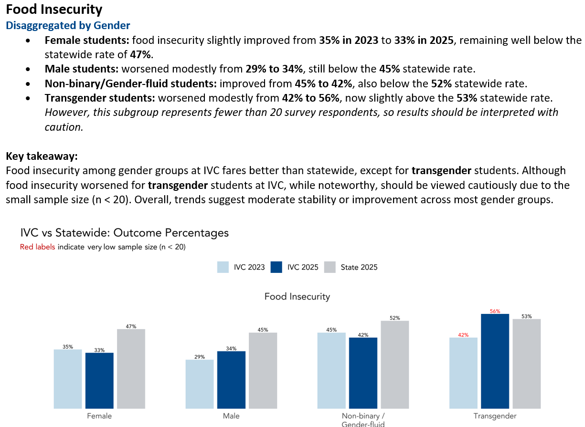
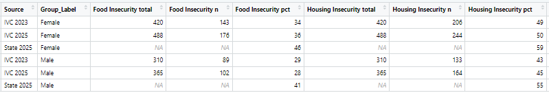
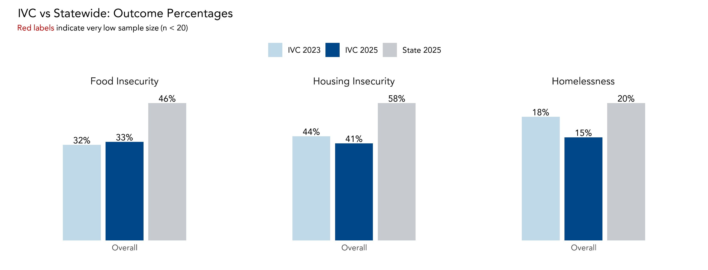
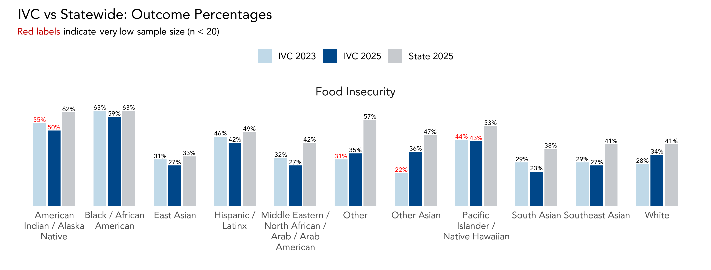

```{r}
#| label: setup
#| include: false

knitr::opts_chunk$set(echo = FALSE, message = FALSE, warning = FALSE)

source("setup.R")

# Layout pieces used in this deck (styles in template/cair.css):
#   {.section-slide}            full-screen blue divider slide
#   {.tile-grid} + {.tile}      row of labels; add .cols-2 / .cols-4
#   {.flow} + {.step}           left-to-right process; .manual for human steps
#   {.takeaway}                 the one line to remember
#   {.placeholder}              stand-in for a screenshot or chart
#   {.fragment}                 reveal one click at a time

# Keep this note inside the chunk: an HTML comment before the first ##
# heading renders as an empty slide.

```

## Sound familiar?

Common challenges with data requests

::::: {.tile-grid}
::: {.tile}
Audience
:::
::: {.tile}
Type of Data
:::
::: {.tile}
Primary Message
:::
::: {.tile}
Tight Timelines
:::
::: {.tile}
Redundancy
:::
:::::

::: {.takeaway .fragment}
Building and formatting eats **precious time**.\
A reproducible, reusable template gives it back.
:::

::: {.notes}
Joshie

Engagement opener:

1. Raise your hand if you've rebuilt the same report more than once.
2. Keep your hand up if you spent so much time creating the report that you lost time to work on other things.

:::


## Why go beyond the dashboard?

<!-- EXAMPLE NEEDED: one real request where a dashboard wasn't enough (e.g., someone looked at the dashboard and still asked "so what does this mean?"). Say it in the notes. -->

Dashboards expanded access to data, but access isn't understanding.

:::: {.columns}
::: {.column width="50%"}
::: {.compare-card .before .fragment}
**Dashboards**

- Show the numbers and filters
- Built for open-ended exploration
- Leave interpretation to the viewer
:::
:::

::: {.column width="50%"}
::: {.compare-card .after .fragment}
**Reports that tell the story**

- Add context and meaning
- Built for specific decisions/committees
- Point to a takeaway and next step
:::
:::
::::

::: {.notes}
Talk about how dashboards are great for exploration but don't tell the story. Reports are still needed to interpret the data and point to action.

This is esp important in the age of AI, where numbers can be spat out quickly, but interpretation and context are still needed to make sense of them, and that's where we come in.
:::


## Today's session

::: {.agenda}
- [0–5 min]{.time} Why it matters
- [5–13 min]{.time} Same data, different end product
- [13–23 min]{.time} Your turn [Interactive]{.badge}
- [23–30 min]{.time} Build it once: workflow & tools
- [30–40 min]{.time} Behind the scenes
- [40–45 min]{.time} Q&A & reflection [Interactive]{.badge}
:::

::: {.takeaway}
Demos use **R**, but the principles apply on any reporting platform (e.g., Python, Word/PowerPoint).
:::

::: {.notes}

:::


# Same Data, Same Design,<br>Different End Product {.section-slide}

Case Study: The #RealCollegeCA Survey: Basic Needs in the CCCs

Administered 2023 · 2025 · next in 2027 (?)

::: {.notes}
State that the survey is recurring, and the 2025 report was rebuilt from scratch. The 2027 report will be built from the same template, with new data dropped in.

⏱ ~5:00. Target: start Your Turn by 13:00.
:::

## Same data, same design, different end product

:::: {.columns}
::: {.column width="38%"}
::: {.version-card}
**#RealCollegeCA · Version 1**

**Audience:** President's Office\
**Purpose:** Various uses (President's welcome talk, Board updates)\
**Product:** Electronic / physical report\
**Format:** PDF
:::

::: {.takeaway}
The **President's Office** needs main ideas, so this version is a **static page** with the takeaway written out (and printable).
:::
:::

::: {.column width="62%"}
{.report-page fig-alt="Page from IVC's #RealCollegeCA report on food insecurity, disaggregated by gender. Bullets give each group's 2023 and 2025 rates against the statewide rate, a key takeaway paragraph says IVC fares better than statewide except for transgender students (n < 20, interpret with caution), and a bar chart compares IVC 2023, IVC 2025, and State 2025 for female, male, non-binary/gender-fluid, and transgender students."}
:::
::::

::: {.notes}
Joshie -- say that the code and how this was done will be discussed later in the presentation.
:::

## Same data, same design, different end product

:::: {.columns}
::: {.column width="38%"}
::: {.version-card}
**#RealCollegeCA · Version 2**

**Audience:** Campuswide\
**Purpose:** Overview + drilldown for specific programs\
**Product:** Interactive report\
**Format:** HTML
:::

::: {.takeaway}
A **campuswide** audience explores on their own, so this version is **interactive**.
:::
:::

::: {.column width="62%"}
**Food Insecurity by Gender**

Overall, food insecurity is most elevated among transgender and non-binary students.

```{r}
#| label: food-insecurity-gender
#| fig-height: 4.2
#| fig-alt: "Interactive grouped bar chart of food insecurity by gender at Fullerton College in 2023 and 2025 compared with the 2025 statewide rate. In 2025, transgender students report 48%, non-binary 42%, female 41%, and male 39%, against a campuswide average of 40%."
# Fixed size in slide pixels: reveal.js scales the slide, so plotly must not
# resize itself to the screen or it overflows on large displays
make_demographic_plot(summary_wide, outcome = "Food_Insecurity", predictor_prefix = "Gender_") |>
  plotly::layout(autosize = FALSE, width = 680, height = 400) |>
  plotly::config(responsive = FALSE)
```
:::
::::

::: {.notes}
Vinnie

Demo: hover over a bar to show values, and toggle the 2023/2025 years. There are multiple versions of this, disaggregated by demographic so people can explore the groups they're interested in, while also seeing this takeaway.

Finding (if asked): food insecurity is most elevated among transgender and non-binary students.
:::

## Different end product, same rules

Our two reports looked different, but underneath we followed the same rules and process.

**What makes a data story work, regardless of its audience?**

::: {.big-idea .fragment}
Reduce cognitive load
:::

::: {.notes}
Joshie
:::

## Reducing cognitive load

::::: {.card-grid .compact}
::: {.card .fragment}
### Consistency

- Same branding and layout within and between reports
- Same chart types for similar data
:::
::: {.card .fragment}
### Inclusivity

- Easy to read
- Alt text
- Color contrast checking
:::
::: {.card .manual .fragment}
### Sense-Making

- Interpret the data for the reader
- Same phrasing, same message for everyone
- Works at any data-literacy level
- State recommendations and next steps
:::
:::::

::::: {.bracket-row}
::: {.bracket .span-2 .fragment}
Automated with templates
:::
::: {.bracket .manual .fragment}
Where our time goes
:::
:::::

::: {.takeaway .tight .fragment}
Automation should eliminate repetitive work, not analytical thinking,<br>
which is why we're **research analysts**.
:::

::: {.notes}
Joshie
:::

## Sense-making: From data to decisions

Every report should help answer:

::::: {.card-grid .quotes}
::: {.card .fragment}
### What's the key takeaway?

"Basic needs insecurities affect the majority of Fullerton College students."

"…the magnitude of inequities varies across groups."
:::
::: {.card .fragment}
### Why does it matter?

"Basic needs challenges may be linked to lower academic performance."
:::
::: {.card .fragment}
### What could someone do next?

"…opportunities to continue strengthening outreach and communication."
:::
:::::

[Quotes from FC's 2025 #RealCollegeCA report]{.source}

::: {.notes}
Vinnie: 
"Be the catalyst." — Loris
:::

## Advocacy from sense-making

:::: {.columns}
::: {.column width="58%"}
**Campuswide**

- Continued Healthy Hornet Meals for students
- Convocation presentation on basic needs

::::: {.fragment fragment-index=1}
**With students**

- Ambassadors promoted basic needs resources
- Journalism class wrote a student article

::: {.takeaway .tight}
We shared the data with students, and they became **advocates**.
:::
:::::
:::

::: {.column width="42%"}
::: {.fragment fragment-index=1}
{fig-align="center" fig-alt="Victoria Kim and Nancy Phan, Fullerton College students named AANHPI Student Ambassador Program Fellows by the Foundation for California Community Colleges, smiling beside a cardboard cutout wearing an APIDA sash."}
:::
:::
::::

::: {.notes}
Sharing data with students turned them into advocates.
:::

# Your Turn {.section-slide}

::: {.notes}
⏱ 13:00. 10 minutes total: ~1 min setup, ~6 min in groups, ~3 min share-out. Target: start Build It Once by 23:00.
:::

## ACTIVITY: How would YOU tell the story?

Campus Climate Survey: one dataset, four audiences

Assume you have the variables and/or results you need. How would you tell the story for each audience?

:::: {.columns}
::: {.column width="58%"}
::::: {.tile-grid .cols-2 .compact}
::: {.tile}
President's Office

"What do I need to know?"
:::
::: {.tile}
Faculty & staff

Campuswide email report
:::
::: {.tile}
Student Equity Committee

"I want to know about our X students."
:::
::: {.tile}
Board of Trustees

"Tell me about the campus climate."
:::
:::::
:::

::: {.column width="42%"}
::: {.steps-panel}
**In your group**

1. **Identify** the key message, context, and implied action.
2. **Choose** a visualization/tool, report format, and framing for your audience.
3. **Share** in one minute: how did your audience change your choices?
:::
:::
::::

::: {.notes}
Reflection prompt to close the share-out: how do storytelling choices shape understanding, decisions, and action?
:::

# A reproducible workflow<br><i>within the report</i> {.section-slide}

#RealCollegeCA 2023 → 2025 → 2027: <br>
build the report once, then drop in new data each cycle

::: {.notes}
⏱ ~23:00. ~7 min for this section. Target: start Behind the Scenes by 30:00.
:::

## A reproducible workflow (within the report)

::::: {.flow}
::: {.step}
Raw data
:::
::: {.step .manual}
Cleaning

Manual + automated
:::
::: {.step}
Visualization

Automated
:::
::: {.step .manual}
Narrative & accessibility

Manual
:::
::: {.step}
Output

PDF · HTML · image
:::
:::::

::: {.takeaway}
Cleaning puts data in the right "format" so everything after it can be automated.
:::

::: {.notes}
JOshie
:::


## Consistent visualizations: design the data first

:::: {.columns}
::: {.column width="50%"}
- Define the variables needed (e.g., year, groupings)
- Define predictor vs. outcome variables
- Choose the data structure (wide vs. long)
:::

::: {.column width="50%"}
- Clean the data
- Stack survey years (2023 + 2025), so 2027 just gets appended
:::
::::

{.wide-figure fig-alt="Screenshot of the summarized data: one row per source (IVC 2023, IVC 2025, State 2025) and gender (Female, Male), with total, n, and percent columns for food and housing insecurity. Statewide rows have percentages only, with NA for counts."}

::: {.notes}
Joshie
:::


## Consistent visualizations: one function, every chart

Create a function to make the same style figures for all predictors to outcomes.

:::: {.columns}
::: {.column width="30%"}
- Branding, colors, fonts
- Clean layout (gridlines, values)
- Legend
- Readable labels
- Warnings
- Export sizes
:::

::: {.column width="70%"}
::::: {.code-scroll}
::: {.code-label}
**1. Wide → long → summarize:** works for any number of groups [(lines 132–150)]{.lines}
:::

```{.r code-line-numbers="false"}
summarise_outcomes <- function(data, student_groups, outcomes,
                               by = c("College", "year"),
                               digits = 0) {
  data %>%
    pivot_longer(all_of(student_groups),
                 names_to = "Student_Group",
                 values_to = "in_group") %>%
    filter(in_group == 1) %>%
    pivot_longer(all_of(outcomes),
                 names_to = "Outcome",
                 values_to = "has_outcome") %>%
    group_by(across(all_of(by)), Student_Group, Outcome) %>%
    summarise(total = sum(!is.na(has_outcome)),
              n = sum(has_outcome == 1, na.rm = TRUE),
              pct = round(100 * n / total, digits),
              .groups = "drop")
}
```

::: {.code-label}
**2. IVC + State in one table** [(lines 237–239)]{.lines}
:::

```{.r code-line-numbers="false"}
summary_long <-
  summarise_outcomes(ivc, student_groups, outcomes) %>%
  bind_rows(statewide) %>%
  mutate(Source = paste(College, year))
```

::: {.code-label}
**3. The plot core:** one bar per source, one panel per outcome [(inside make_comparison_plot)]{.lines}
:::

```{.r code-line-numbers="false"}
ggplot(plot_data,
       aes(x = Group_Label, y = pct, fill = Source)) +
  geom_col(position = position_dodge(width = 0.72),
           width = 0.64) +
  geom_text(aes(label = bar_label, color = low_n,
                group = Source),
            position = position_dodge(width = 0.72),
            vjust = -0.25) +
  facet_wrap(~ Outcome, nrow = 1) +
  scale_fill_manual(values = fill_colors)
# ... theme settings
```

::: {.code-label}
**4. Every group x outcome combination in one loop** instead of 12 copy-pasted calls [(lines 270–277)]{.lines}
:::

```{.r code-line-numbers="false"}
plot_grid <- expand_grid(group_set = names(group_sets),
                         outcome = outcomes)

group_plots <- pmap(plot_grid, function(group_set, outcome) {
  build_plot(group_sets[[group_set]], outcome,
             size = plot_sizes[[group_set]] %||%
               plot_sizes$default)
})
```
:::::
:::
::::


## The result: IVC vs. statewide

{width="100%" fig-alt="Grouped bar chart of IVC vs. statewide outcome percentages for three outcomes."}

::: {.notes}
One function call per outcome: same colors, same layout, same labels.
:::

## Same function, disaggregated

{width="100%" fig-alt="Grouped bar chart of food insecurity by race/ethnicity, IVC 2023 and 2025 vs. statewide 2025. Groups with fewer than 20 respondents are labeled in red."}

::: {.notes}
Same function, now by race/ethnicity: only the grouping changed.
Point out the red labels for n < 20: the warning is built into the function, so it's never forgotten.
:::

## What changes in 2027

::::: {.flow .detail}
::: {.step .manual .fragment}
2025: rebuild

Cleaned, charted, and formatted the #RealCollegeCA report
:::
::: {.step .fragment}
2027: re-render

New data in, same template, same functions, report out
:::
::: {.step .manual .fragment}
The time we get back

Sense-making: interpretation, context, and recommendations for action
:::
:::::

::: {.takeaway .fragment}
**Automate** the reporting, so we can **elevate** the storytelling.
:::

::: {.notes}
Bring it back to the case study: the 2027 report is a re-render, not a rebuild. The time saved goes to the parts that can't be automated: interpreting, and sharing the data so it turns into action, like the students who became advocates.
:::


# A reproducible workflow <br><i>between reports</i>  {.section-slide}

build the template once, then use it for multiple reports

## A reproducible workflow (between reports)

::::: {.flow .detail}
::: {.step .manual}
Where I started: copy `setup.R`

Paste it into each new report, then manually delete/add what's relevant.

**Examples:** libraries, functions, themes
:::
::: {.step .fragment fragment-index=1}
Where I am now: an R package

Package calls report templates, functions, and themes.

One version, loaded everywhere with `library()`.

**Examples:** `use_report(format = "pdf")`, `use_presentation()`, `+ theme_fc()`
:::
:::::


::: {.notes}
Vinnie
:::

## A reproducible workflow (between reports)

::: {.video-center}
<video src="figures/r_report_template.mp4" controls preload="auto" height="560"></video>
:::

::: {.notes}
Vinnie
:::

## Example toolkit: R

::::: {.columns .toolkit-split}
:::: {.column width="34%"}
::: {.card}
[R]{.card-title}
*the analyses of the report*

- Data cleaning and analyses
- Reusable chart functions
- Create a package or reusable file
:::
::::

:::: {.column width="66%"}
::: {.code-scroll .wrap}
::: {.code-label}
**setup.R**
:::

```{.r code-line-numbers="false"}
# ---- Libraries ----
library(tidyverse) # data wrangling/viz
library(plotly) # cool charts
library(here) # file paths
library(readxl) # Excel import
library(writexl) # Excel export
library(haven) # SPSS/SAS/Stata import
library(glue) # Flexible text interpolation
library(flextable) # pretty tables
library(ggtext) # rich text in ggplot (HTML/Markdown)
library(ragg) # raster rendering for plots
library(extrafont) # font management
library(htmltools) # html in reports
library(quarto) #render quarto from R

loadfonts(device = "win", quiet = TRUE)

# ---- Fullerton College Color Palette ----
fc_colors <- c(
  "Blue" = "#0F406B",
  "Yellow" = "#FFD600",
  "Sky" = "#375E9E",
  "Creek" = "#5DCCD4",
  "Breeze" = "#BAEEED",
  "LemonZest" = "#F5F3BF",
  "Rustic" = "#E6605B",
  "Elderberry" = "#1B0D42"
)

# Neutral tone for text, lines, etc.
fc_blue <- "#0F406B"
fc_gray <- "#333333"

# ---- FC ggplot Theme ----
theme_fc <- function(base_size = 12, base_family = "Century Gothic") {
  theme_minimal(base_size = base_size, base_family = base_family) +
    theme(
      text = element_text(family = base_family, color = fc_gray),
      plot.title = element_text(
        face = "bold",
        color = fc_colors["Blue"],
        size = rel(1.2),
        hjust = 0.5
      ),
      plot.subtitle = element_text(color = fc_gray, hjust = 0.5),
      axis.title = element_text(color = fc_gray, face = "bold"),
      axis.text = element_text(color = fc_gray),
      panel.grid.major = element_line(color = "#DDDDDD"),
      panel.grid.minor = element_blank(),
      plot.caption = element_text(color = fc_gray, size = rel(0.9), hjust = 1),
      legend.title = element_text(color = fc_gray, face = "bold"),
      legend.text = element_text(color = fc_gray),
      plot.margin = margin(10, 10, 10, 10)
    )
}


# Color and fill scales for ggplot2 using the FC color palette

scale_fill_fc <- function(..., discrete = TRUE) {
  if (discrete) {
    scale_fill_manual(values = rep(unname(fc_colors), length.out = 20), ...)
  } else {
    scale_fill_gradientn(colours = unname(fc_colors), ...)
  }
}

scale_color_fc <- function(..., discrete = TRUE) {
  if (discrete) {
    scale_color_manual(values = rep(unname(fc_colors), length.out = 20), ...)
  } else {
    scale_color_gradientn(colours = unname(fc_colors), ...)
  }
}

# Set as default ggplot theme, yay!
theme_set(theme_fc())

```
:::
::::
:::::

::: {.notes}
Vinnie
:::

## Example toolkit: Quarto

::::: {.columns .toolkit-split}
:::: {.column width="34%"}
::: {.card}
[Quarto]{.card-title}
*the document itself*

- Reports & slides from one file
- HTML, PDF, Word
- Parameterized reports
:::

::: {.takeaway .fragment}
**Why Quarto over R Markdown?** <br>Better multi-language support and standardized YAML implementation
:::
::::

:::: {.column width="66%"}
::: {.code-scroll .wrap}
::: {.code-label}
**Report template (.qmd)**
:::

<!-- {{r}} displays as {r} without running the chunk inside this deck -->
````{.markdown code-line-numbers="false"}
---
title: "Report Title"
subtitle: "Subtitle or Term (e.g. Fall 2026)"
author: "Vinnie Wu"
date: today
date-format: "MMMM D, YYYY"
---


```{{r}}
#| label: setup
#| include: false

knitr::opts_chunk$set(echo = FALSE, message = FALSE, warning = FALSE)

source("setup.R")

```

::: {style="text-align:center;"}

:::

## Overview {.section-slide}

Blah blah blah

## Agenda

- First topic
- Second topic
- Third topic
- Questions & discussion
````
:::
::::
:::::

## Example toolkit: Templates

::::: {.columns .toolkit-split}
:::: {.column width="34%"}
::: {.card}
[Templates]{.card-title}
*the design of the report*

- One template per format: HTML, PDF, slides
- HTML & slides: CSS for branding & layout
- PDF: a print-ready template for the same look on paper
:::

::: {.takeaway .fragment}
**Don't use R?** Templates can be created in Word, PowerPoint, Tableau/PowerBI, or your coding language.
:::
::::

:::: {.column width="66%"}
::: {.code-scroll .wrap}
::: {.code-label}
**Branding CSS**
:::

```{.css code-line-numbers="false"}
h1, h2, h3, h4 {
  font-family: var(--font-body);
  color: var(--fc-blue);
  font-weight: 700;
  margin-top: 1em;
  margin-bottom: 0.5em;
}

h1 {
  border-bottom: 2px solid var(--fc-blue);
  padding-bottom: 4px;
}

h2, h3 {
  border-inline-start: 5px solid var(--fc-blue);
  padding-inline-start: var(--space-sm);
}

h3 {
  font-style: italic;
  font-weight: 600;
}

/* Subtitle (below report title) */
#subtitle {
  font-family: var(--font-body);
  font-size: var(--subtitle-size);
  font-weight: 700;
  color: var(--fc-gray);
  letter-spacing: 0.5px;
  margin: 10px 0 32px;
  border: none !important;
}
```
:::
::::
:::::

## Scaling reports: parameterized reporting

<!-- EXAMPLE NEEDED:  Show (1) the render loop (a few lines of code), (2) one output report, and (3) numbers: N reports, hours by hand vs. minutes now. Also mention how small n / FERPA is handled per report. -->

- Faculty Senate requested a report of disaggregated course success rates for every faculty member (~700+) to be sent annually.
- Specific requirements: an emailed .pdf, guided questions for interpretation

::: {.placeholder .tall}
Faculty course success report: one template, a report per faculty member, IDK TBD
:::

::: {.notes}
Vinnie: present the faculty course success data scenario.
:::


# Wrap-up {.section-slide}

::: {.notes}
⏱ 40:00. Keep the conclusion to ~1 min to leave room for Q&A and the reflection.
:::


## What to automate, and what not to

:::: {.columns}
::: {.column width="50%"}
::: {.compare-card .after}
**Automate**

- Recurring cleaning steps
- Charts for every group
- Branding and formatting
- One report to be customized as needed

::: {.ai-note .fragment fragment-index=1}
**AI can help:** debugging code, alt text, contrast checks
:::
:::
:::

::: {.column width="50%"}
::: {.compare-card .before}
**Don't automate**

- What the results mean
- Campus context and history
- Small-sample judgment calls
- Recommendations and conclusions

::: {.ai-note .fragment fragment-index=1}
**AI isn't perfect:** verifying code, checking alt text
:::
:::
:::
::::


::: {.notes}
Even if AI can help with repetitive tasks, 1) it isn't always correct and 2) it can't provide context or the framing you need for your specific audience.
:::


# Thank you! Questions? {.section-slide}

**Before you go:** think of one recurring report you build.<br>
What's one improvement from today you could try on it?

::: {.thanks-panel}
<!-- QR CODE: replace the placeholder div below with
     {width="200" fig-alt="QR code linking to the GitHub repository"} -->
::: {.qr-placeholder}
QR code
:::

::: {.thanks-info}
**Sample code & slides**\
[github.com/somethingsomething](https://github.com/wu-vinnie/sharedquests/tree/main/CAIR26)

Vinnie Wu · [vwu@fullcoll.edu](mailto:vwu@fullcoll.edu)\
Joshua Rhee · [jrhee@ivc.edu](mailto:jrhee@ivc.edu)
:::
:::

::: {.notes}
Leave this slide up during Q&A so people can scan the QR code.
:::
